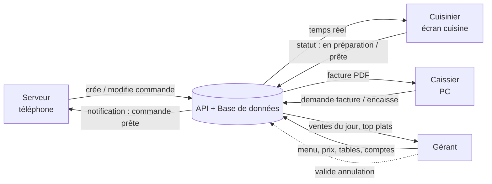
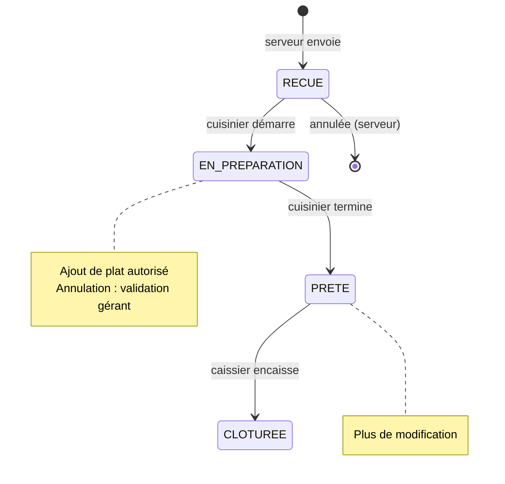
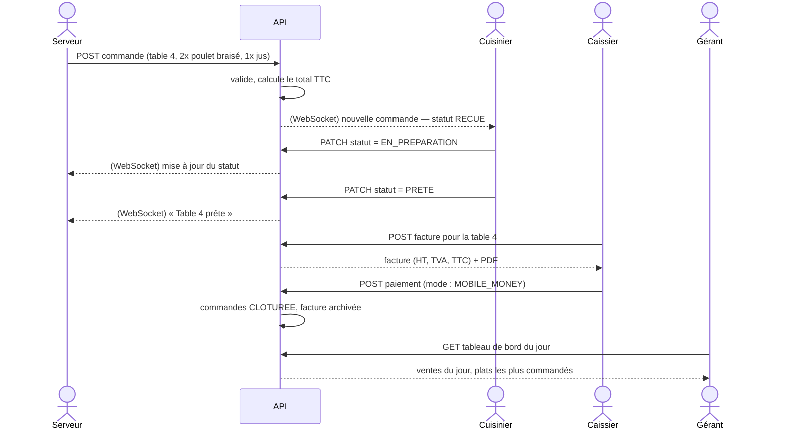
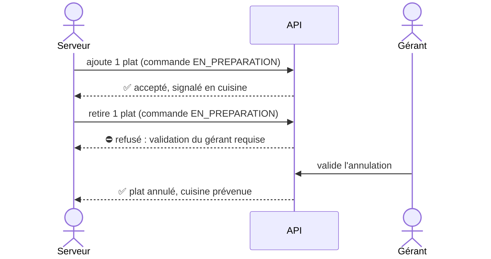
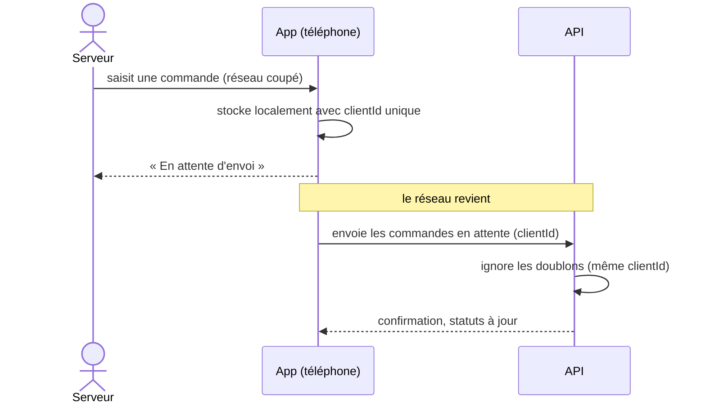

# 02 — Acteurs et interactions

## Acteurs et responsabilités

| Acteur | Appareil | Responsabilités | Ne peut pas |
|---|---|---|---|
| **Serveur** | Téléphone | Prendre la commande par table, l'envoyer en cuisine, la modifier selon son statut, voir l'état de ses commandes | Encaisser, modifier le menu, annuler un plat en préparation sans le gérant |
| **Cuisinier** | Écran cuisine | Voir les commandes à préparer, passer *en préparation* puis *prête* | Créer ou modifier une commande, voir les prix et les factures |
| **Caissier** | PC | Encaisser, choisir le mode de paiement, éditer/imprimer la facture, clôturer la table | Modifier le menu, changer le contenu d'une commande |
| **Gérant** | PC / téléphone | Gérer menu, prix, disponibilité, tables et comptes ; consulter le tableau de bord et les factures ; valider les annulations en préparation | — |
| **Système** | Serveur | Pousser les commandes en temps réel, calculer les totaux et la TVA, numéroter et archiver les factures, synchroniser le mode hors ligne | — |

## Vue d'ensemble

## Cycle de vie d'une commande

## Scénario principal : de la commande à la facture

## Scénario : modification et annulation

## Scénario : mode hors ligne (serveur)

## Échanges clés (résumé)

| De → Vers | Information | Mode |
|---|---|---|
| Serveur → Système | Nouvelle commande, ajout/retrait de plat | Requête HTTP (file locale si hors ligne) |
| Système → Cuisinier | Commande à préparer | Temps réel (WebSocket) |
| Cuisinier → Système | Changement de statut | Requête HTTP |
| Système → Serveur | Statut mis à jour, « commande prête » | Temps réel (WebSocket) |
| Caissier → Système | Demande de facture, paiement | Requête HTTP |
| Gérant → Système | Menu, prix, comptes, validation d'annulation | Requête HTTP |
| Système → Gérant | Ventes du jour, plats les plus commandés | Requête HTTP |
