# 03 — Architecture

## Choix techniques et justifications

| Domaine | Choix | Pourquoi |
|---|---|---|
| Langage | **TypeScript** (front et back) | Une seule langue, typage qui aide l'agent à ne pas se tromper, maîtrisé par l'équipe |
| Serveur | **Node.js 20 + Express** | Simple, très documenté : l'agent le connaît bien, peu de « magie » |
| Temps réel | **Socket.IO** (WebSocket) | La commande doit apparaître en cuisine sans rafraîchir ; reconnexion automatique, utile avec un réseau parfois instable |
| Base de données | **PostgreSQL** + **Prisma** | Transactions fiables pour l'argent (facture, paiement) ; Prisma génère les types et les migrations versionnées |
| Frontend | **React + Vite**, installable en **PWA** | Une seule app responsive (téléphone, PC, écran cuisine) ; la PWA permet le mode hors ligne |
| Hors ligne | **Service worker + IndexedDB** (file d'attente) | Limité à la saisie des commandes par les serveurs (hypothèse H3) |
| Authentification | **JWT** + **bcrypt**, rôles | Un compte par personne, droits par rôle |
| Validation | **Zod** | Valider chaque entrée à la frontière de l'API |
| PDF | **pdf-lib** (côté serveur) | Génère la facture PDF archivée sans navigateur sans tête |
| Impression | CSS d'impression (`@media print`) | Imprime depuis le navigateur du PC de caisse, sans pilote spécifique |
| Tests | **Vitest** (unitaires) + **Supertest** (API) | Rapides, en TypeScript, faciles à lancer par l'agent |

### Décisions d'architecture

- **Monolithe modulaire** : un serveur, un client. Un seul restaurant, pas de microservices.
- **Logique métier isolée** dans `server/src/domain/` (fonctions pures, sans base ni HTTP). C'est la zone la plus testée et la plus facile à déléguer.
- **Argent en entiers FCFA**. TVA 18 % incluse : `HT = round(TTC / 1.18)`, `TVA = TTC − HT`.
- **Prix figés** : une ligne de commande copie le nom et le prix du plat au moment de la commande, pour qu'un changement de prix n'altère pas les factures passées.
- **Idempotence** : une commande envoyée hors ligne porte un `clientId` ; le serveur ignore un second envoi identique.

## Modèle de données

```mermaid
erDiagram
    USER ||--o{ ORDER : "sert (serveur)"
    DINING_TABLE ||--o{ ORDER : "reçoit"
    ORDER ||--|{ ORDER_ITEM : "contient"
    MENU_ITEM ||--o{ ORDER_ITEM : "référencé par"
    INVOICE ||--|{ ORDER : "regroupe"
    INVOICE ||--o| PAYMENT : "réglée par"
    USER ||--o{ INVOICE : "émise par (caissier)"

    USER {
        uuid id PK
        string name
        string email UK
        string passwordHash
        enum role "SERVEUR|CUISINIER|CAISSIER|GERANT"
        bool active
    }
    MENU_ITEM {
        uuid id PK
        string name
        string category
        int priceFcfa "TTC, entier"
        bool available
    }
    DINING_TABLE {
        uuid id PK
        string name
        string room "salle 1, 2 ou 3"
    }
    ORDER {
        uuid id PK
        string clientId UK "idempotence hors ligne"
        uuid tableId FK
        uuid serverId FK
        enum status "RECUE|EN_PREPARATION|PRETE|CLOTUREE"
        uuid invoiceId FK "nullable"
        datetime createdAt
    }
    ORDER_ITEM {
        uuid id PK
        uuid orderId FK
        uuid menuItemId FK
        string nameSnapshot
        int unitPriceFcfa
        int quantity
        string note
        enum state "ACTIVE|ANNULEE|ANNULATION_DEMANDEE"
    }
    INVOICE {
        uuid id PK
        string number UK "F-AAAAMMJJ-0001"
        int totalTtcFcfa
        int totalHtFcfa
        int vatFcfa
        string pdfPath
        datetime issuedAt
        uuid cashierId FK
    }
    PAYMENT {
        uuid id PK
        uuid invoiceId FK
        enum method "ESPECES|MOBILE_MONEY|CARTE"
        int amountFcfa
        datetime paidAt
    }
```



## API (routes principales et rôles)

| Route | Rôles | Rôle de la route |
|---|---|---|
| `POST /api/auth/login` | public | Connexion, renvoie un JWT |
| `GET /api/menu` | tous | Liste du menu (disponibles pour le serveur, tous pour le gérant) |
| `POST /api/menu`, `PATCH /api/menu/:id` | GERANT | Créer/modifier plat, prix, disponibilité |
| `POST /api/orders` | SERVEUR | Créer une commande (avec `clientId`) |
| `POST /api/orders/:id/items` | SERVEUR | Ajouter un plat (selon statut) |
| `DELETE /api/orders/:id/items/:itemId` | SERVEUR, GERANT | Retirer/annuler (selon statut, validation gérant) |
| `GET /api/kitchen/orders` | CUISINIER | Commandes à préparer |
| `PATCH /api/orders/:id/status` | CUISINIER | Faire avancer le statut |
| `POST /api/tables/:id/invoice` | CAISSIER | Générer la facture d'une table |
| `POST /api/invoices/:id/pay` | CAISSIER | Enregistrer le paiement, clôturer |
| `GET /api/invoices/:id/pdf` | CAISSIER, GERANT | Télécharger le PDF archivé |
| `GET /api/dashboard/daily` | GERANT | Ventes du jour, plats les plus commandés |

Événements Socket.IO : `order:created`, `order:updated`, `order:ready`.

## Arborescence cible

```text
chez-mama-rita-agent-workflow/
├── README.md
├── AGENTS.md
├── CLAUDE.md
├── journal.md
├── package.json
├── tsconfig.json
├── vitest.config.ts
├── .env.example
├── docs/                      # préparation (01 à 05)
├── tests/                     # écrits AVANT le code
│   ├── helpers/
│   ├── unit/                  # logique pure
│   └── api/                   # routes, base de test
├── shared/
│   └── types.ts               # types partagés front/back (rôles, statuts)
├── server/
│   ├── prisma/
│   │   ├── schema.prisma
│   │   └── seed.ts
│   └── src/
│       ├── app.ts             # createApp() : Express sans listen
│       ├── index.ts           # démarrage + Socket.IO
│       ├── domain/            # LOGIQUE MÉTIER PURE
│       │   ├── pricing.ts     # TVA, totaux
│       │   └── order-rules.ts # transitions de statut, règles de modification
│       ├── routes/            # auth, menu, orders, kitchen, billing, dashboard
│       ├── middleware/        # auth JWT, contrôle de rôle, validation Zod
│       ├── services/          # accès base + orchestration
│       ├── realtime/          # Socket.IO
│       └── testing/           # resetDb(), seedTestUsers(), pour les tests API
└── client/
    ├── index.html
    └── src/
        ├── pages/             # Login, Serveur, Cuisine, Caisse, Gerant
        ├── components/
        ├── offline/           # file d'attente IndexedDB + synchro
        ├── api/
        └── main.tsx
```

## Contrat avec les tests

Les tests existants (`tests/`) imposent les points d'entrée suivants. L'agent doit les créer tels quels :

- `server/src/domain/pricing.ts` exporte `splitVat`, `orderTotalFcfa`, `formatFcfa`
- `server/src/domain/order-rules.ts` exporte `canTransition`, `canAddItem`, `canRemoveItem`
- `server/src/app.ts` exporte `createApp()`
- `server/src/testing/index.ts` exporte `resetDb()`, `seedTestData()`, `tokenFor(role)`

## Risques et garde-fous

| Risque | Garde-fou |
|---|---|
| Erreurs d'arrondi sur la TVA | Entiers FCFA, calcul unique dans `pricing.ts`, tests dédiés |
| Doublons de commandes à la synchronisation hors ligne | `clientId` unique, idempotence testée |
| Agent qui modifie les tests pour les faire passer | Interdit dans `AGENTS.md`, validation humaine requise |
| Mauvaise modification qui casse le projet | Une tâche = une branche, petits commits, retour au dernier commit sain |
