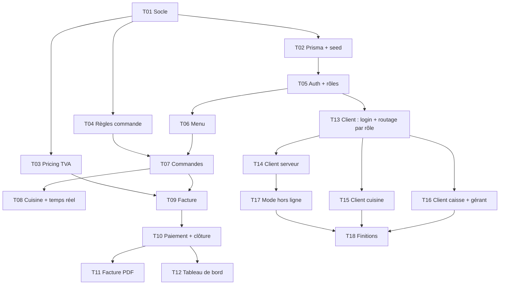

# 04 — Plan de tâches

Chaque tâche est courte (≈ une session de l'agent, ~150 lignes), a des critères d'acceptation **vérifiables** et des dépendances. L'agent exécute **une tâche à la fois**. Statut : ⬜ à faire · 🟨 en cours · ✅ terminée.

## Vue des dépendances

## Tâches

### T01 — Socle du projet
- **Dépend de** : aucune
- **À faire** : initialiser `server/` (Express + TypeScript), `app.ts` exportant `createApp()`, route `GET /api/health`, scripts npm, lint.
- **Critères d'acceptation** :
  - `npm install` et `npm run typecheck` passent.
  - `GET /api/health` répond `200 {"status":"ok"}`.

### T02 — Base de données et jeu de données
- **Dépend de** : T01
- **À faire** : `schema.prisma` selon `docs/03` ; migration initiale ; `seed.ts` (4 utilisateurs, 3 salles/tables, ~10 plats) ; `testing/` avec `resetDb`, `seedTestData`, `tokenFor`.
- **Critères** : `npx prisma migrate dev` réussit ; `npm run seed` crée les données ; `resetDb()` vide la base de test.

### T03 — Calcul de la TVA et des totaux
- **Dépend de** : T01
- **À faire** : `domain/pricing.ts` (`splitVat`, `orderTotalFcfa`, `formatFcfa`).
- **Critères** : `npm run test:unit -- pricing` vert ; aucun `float` ; 11 800 FCFA → HT 10 000 / TVA 1 800.

### T04 — Règles de commande
- **Dépend de** : T01
- **À faire** : `domain/order-rules.ts` (`canTransition`, `canAddItem`, `canRemoveItem`) selon la règle de `docs/01`.
- **Critères** : `npm run test:unit -- order-rules` vert.

### T05 — Authentification et rôles
- **Dépend de** : T02
- **À faire** : `POST /api/auth/login`, middleware JWT, middleware `requireRole(...)`.
- **Critères** : mauvais mot de passe → 401 ; route protégée sans jeton → 401 ; mauvais rôle → 403 ; `npm run test:api -- auth` vert.
- ⚠️ **Validation humaine** (touche à l'authentification).

### T06 — Gestion du menu
- **Dépend de** : T05
- **À faire** : `GET/POST/PATCH /api/menu`, plat indisponible exclu pour le serveur.
- **Critères** : `npm run test:api -- menu` vert (gérant crée/modifie, serveur refusé en écriture).

### T07 — Prise de commande
- **Dépend de** : T04, T06
- **À faire** : `POST /api/orders` (avec `clientId`), ajout/retrait de plat selon le statut, prix figés dans la ligne.
- **Critères** : `npm run test:api -- orders` vert ; deux envois du même `clientId` créent une seule commande.

### T08 — Cuisine et temps réel
- **Dépend de** : T07
- **À faire** : `GET /api/kitchen/orders`, `PATCH /api/orders/:id/status`, Socket.IO (`order:created`, `order:updated`, `order:ready`).
- **Critères** : `npm run test:api -- kitchen` vert ; transition illégale → 409 ; seul le cuisinier peut changer le statut.

### T09 — Génération de la facture
- **Dépend de** : T03, T07
- **À faire** : `POST /api/tables/:id/invoice` : regroupe les commandes prêtes non facturées, calcule HT/TVA/TTC, numéro `F-AAAAMMJJ-0001`.
- **Critères** : `npm run test:api -- billing` vert ; total facture = somme des lignes ; numéros uniques et continus.

### T10 — Paiement et clôture
- **Dépend de** : T09
- **À faire** : `POST /api/invoices/:id/pay` (espèces, Mobile Money, carte), commandes → `CLOTUREE`.
- **Critères** : paiement d'un montant différent du total refusé ; double paiement refusé ; test vert.

### T11 — Facture PDF et archivage
- **Dépend de** : T10
- **À faire** : génération PDF (pdf-lib) stockée dans `storage/invoices/`, `GET /api/invoices/:id/pdf`.
- **Critères** : la route renvoie `application/pdf` non vide ; accessible au caissier et au gérant seulement.

### T12 — Tableau de bord du gérant
- **Dépend de** : T10
- **À faire** : `GET /api/dashboard/daily` : total des ventes du jour, nombre de commandes, plats les plus commandés (top 5).
- **Critères** : `npm run test:api -- dashboard` vert ; seul le gérant y accède.

### T13 — Client : connexion et routage par rôle
- **Dépend de** : T05
- **À faire** : app React + Vite, page de connexion, redirection selon le rôle, stockage du jeton.
- **Critères** : un serveur arrive sur la page Serveur, un cuisinier sur la page Cuisine, etc. ; interface en français.

### T14 — Client serveur (téléphone)
- **Dépend de** : T13
- **À faire** : choix de la table, ajout de plats, envoi, suivi des statuts, notification « prête ».
- **Critères** : utilisable en 360 px de large ; la commande envoyée apparaît côté API.

### T15 — Client cuisine (écran)
- **Dépend de** : T13
- **À faire** : liste des commandes en temps réel, boutons de changement de statut, mise en évidence des plats ajoutés.
- **Critères** : une commande envoyée apparaît sans rafraîchir la page.

### T16 — Client caisse et gérant
- **Dépend de** : T13
- **À faire** : écran caisse (facture, paiement, impression CSS, PDF) ; écran gérant (menu, tableau de bord, validation d'annulation).
- **Critères** : impression lisible en format ticket ; montants affichés en FCFA sans décimales.

### T17 — Mode hors ligne (serveur)
- **Dépend de** : T14
- **À faire** : service worker, file IndexedDB, envoi différé avec `clientId`, indicateur « en attente d'envoi ».
- **Critères** : réseau coupé → la commande est mise en file ; retour du réseau → envoyée une seule fois.

### T18 — Finitions et démonstration
- **Dépend de** : T15, T16, T17
- **À faire** : messages d'erreur, `README` mis à jour (captures), parcours de démonstration complet.
- **Critères** : `npm test` vert en entier ; parcours serveur → cuisine → caisse → gérant déroulé sans erreur.

## Règles transverses

- Une tâche = une branche `tache/Txx-nom` = une revue humaine avant fusion.
- Les tests de `tests/` ne sont **jamais** modifiés pour faire passer une tâche.
- Si une tâche dépasse ~150 lignes, l'agent la redécoupe et le signale.
