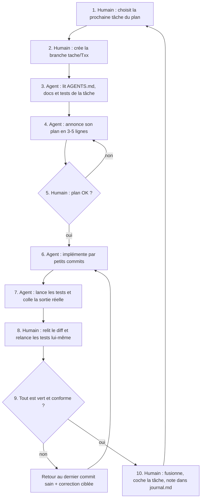

# 05 — Workflow agent

Principe : **l'agent exécute, l'humain décide et vérifie.** On ne fait jamais confiance à un « c'est fait » sans preuve.

## Les étapes

## Ce qui est délégué à l'agent

- Écrire le code d'une tâche du plan, en suivant `AGENTS.md` et `docs/03-architecture.md`.
- Faire passer les tests existants.
- Créer les fichiers prévus dans l'arborescence cible.
- Lancer les tests, le typecheck et rapporter les résultats.
- Proposer des améliorations (sans les appliquer).

## Ce qui est validé par un humain

| Point de contrôle | Pourquoi |
|---|---|
| Le plan annoncé par l'agent avant de coder | Éviter de partir dans la mauvaise direction |
| Le diff complet de chaque tâche | Détecter le travail non fait ou mal fait |
| **Relancer soi-même `npm test`** | L'agent peut dire « terminé » sans l'avoir fait |
| Toute modification de test | Un test ne doit pas être affaibli pour passer |
| Authentification, rôles, mots de passe | Sécurité |
| Nouvelle dépendance, changement de modèle de données | Cohérence de l'architecture |
| Modification d'`AGENTS.md`, de `docs/` ou du plan | Le cadre appartient à l'humain |
| La fusion dans `main` | Dernier verrou |

## Anti-pannes : protéger le travail

Deux problèmes réels observés avec les agents ont guidé ces règles :
1. **L'agent annonce une tâche faite alors qu'elle ne l'est pas.** → preuve obligatoire (sortie de test, `git diff --stat`) et vérification humaine systématique.
2. **L'agent applique mal une modification et abîme le projet.** → une tâche par branche, commits fréquents, petits changements, et retour au dernier commit sain plutôt que d'empiler des correctifs.

## Utiliser plusieurs agents

Le dépôt est conçu pour qu'on puisse changer d'agent (Claude Code, Cursor, Codex…) sans perdre le contexte : tout ce qu'un agent doit savoir est dans `AGENTS.md`, `docs/` et `tests/`, pas dans une conversation.

Consigne type à donner à un nouvel agent :

> Lis `AGENTS.md`, puis `docs/04-plan.md`. Exécute la tâche **T0X** uniquement. Annonce d'abord ton plan, attends mon accord, puis implémente et prouve avec la sortie des tests.

## Journal

Après chaque tâche, ajouter une entrée à `journal.md` : ce qui a été demandé, ce que l'agent a fait, ce qui a été corrigé, la décision prise.
